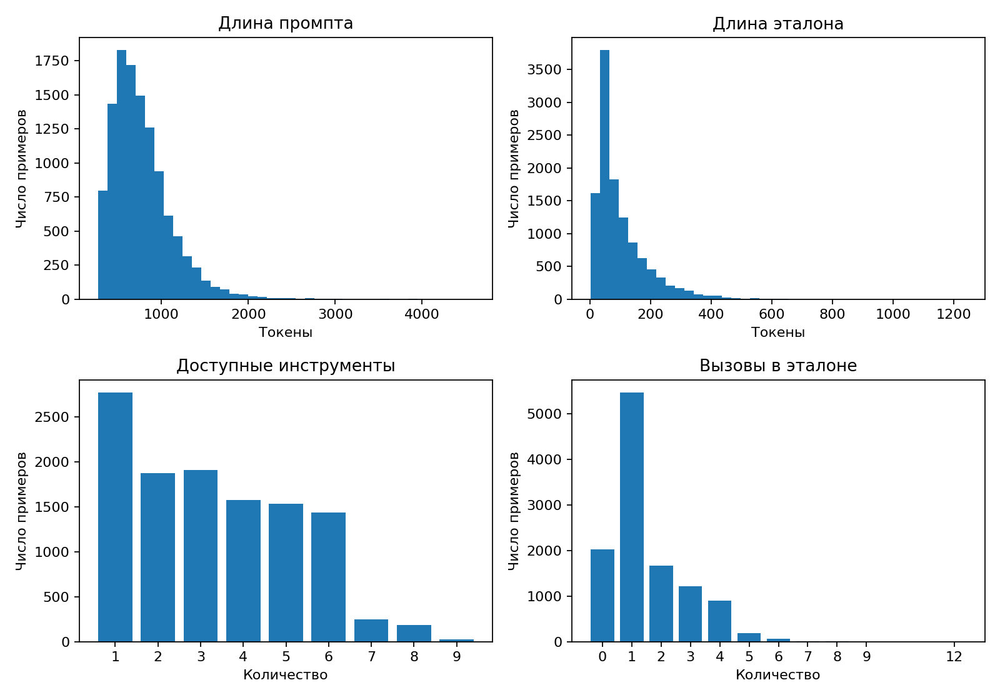
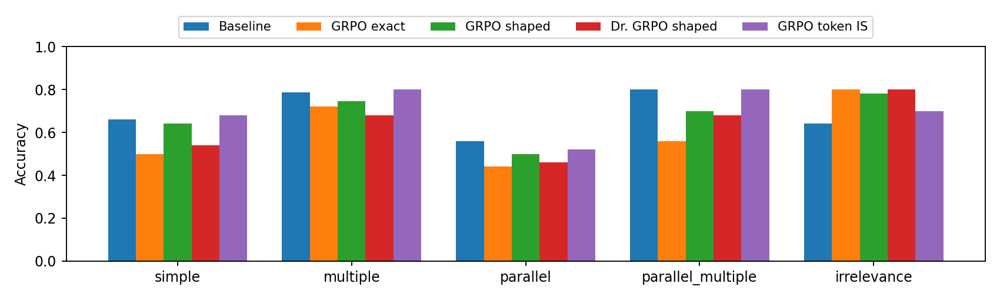
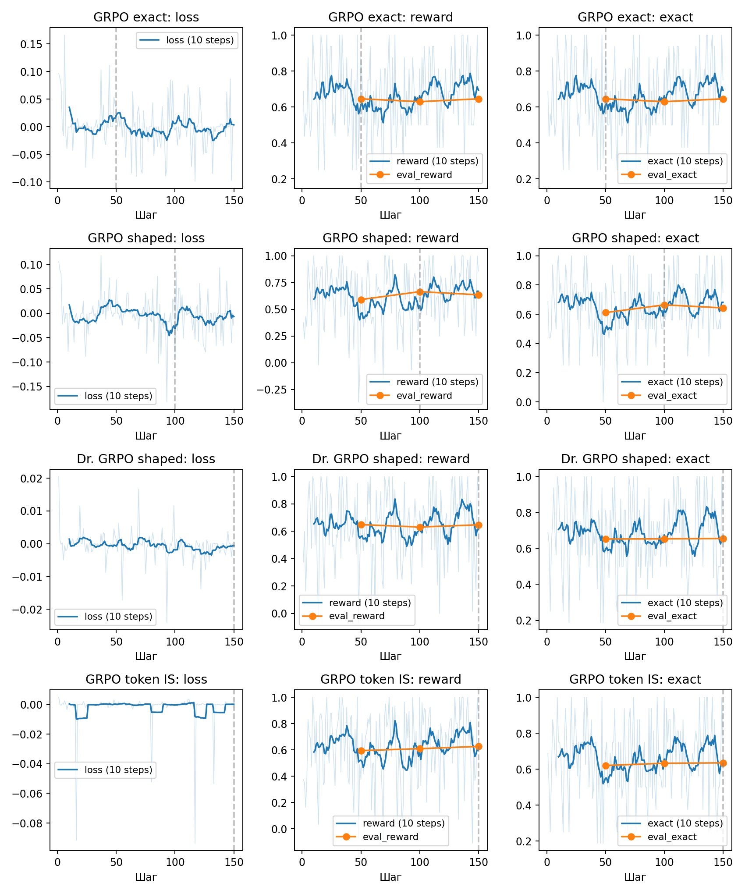

# ДЗ-5. RL для вызова инструментов

<!-- status:start -->
<!-- status:end -->

## Данные

Как данные смотрим на `Team-ACE/ToolACE`. Вызовы разбираются без исполнения: сначала выделяются имя функции и скобки с учётом строк, затем читаются аргументы через AST. Это позволяет сохранить функции с пробелами в именах.
Целью RL становится ответ ассистента непосредственно после сообщения пользователя. Предыдущие ответы и результаты инструментов остаются в истории. Пересказ результата сразу после tool-сообщения не становится отдельной целью: иначе было бы слишком много простых примеров без вызова. Эталон текущего ответа используется только в reward, в prompt его нет. Это обучение RL без SFT.

Перед построением префиксов делаются уникальные диалоги на train/validation в пропорции 90/10. Части одного диалога попадают только в один сплит. Дополнительно исключил из validation промпты, полностью совпадающие с промптами train, даже если они происходят из разных диалогов. Затем удаляются повреждённые вызовы, несогласованные со схемой эталоны и слишком длинные примеры

В train беру до 6000 примеров, целевая доля ответов без вызова — 25%; в validation до 256 примеров без изменения естественной доли классов.

<!-- eda:start -->

В исходной версии ToolACE 11300 диалогов; после удаления точных дубликатов — 11282. В разобранных JSON-описаниях найдено 16128 уникальных имён инструментов.

| Сплит | Примеров | Диалогов | Без вызова | Один вызов | Несколько вызовов |
|---|---:|---:|---:|---:|---:|
| train | 6000 | 5490 | 1500 | 2615 | 1885 |
| validation | 256 | 252 | 48 | 106 | 102 |

Отфильтрованные случаи: `invalid_reference_or_history` — 108; `empty_answer` — 5; `long_prompt` — 11; `unsupported_tools_format` — 745; `duplicate_dialogue` — 18; `long_answer` — 3; `duplicate_validation_prompt` — 7.

| Длина, токены | Медиана | p90 | p99 | Максимум |
|---|---:|---:|---:|---:|
| Промпт | 705 | 1209 | 1928 | 4593 |
| Эталон | 68 | 215 | 425 | 1241 |

Квантили вычислены до фильтрации по длине, после разбора и проверки схем.



<!-- eda:end -->

## Награда

Обозначения: C — предсказанное мультимножество вызовов, Y — эталон; E = 1[C = Y]. Порядок вызовов не важен, но кратность важна: лишний повтор не исчезает при сравнении. Ключи словарей сравниваются без учёта порядка, строки и значения аргументов — строго. Вложенные массивы сохраняют порядок. Числа 1 и 1.0 считаю одинаковыми, но строки и булевы значения не приравниваю к числам: это учитывает преобразование чисел штатным парсером.

**Exact:** `R_exact = E` для корректного завершённого ответа; для пустого, обрезанного или повреждённого ответа — 0. При Y = ∅ нужен непустой текст без вызовов. Смысл естественного ответа отдельно не оценивается.

**Shaped:** если ответ повреждён или решение «вызывать / не вызывать» неверно, `R_shaped = −1`. Если вызов не требуется и модель вернула непустой текст без вызова, награда равна 1. В остальных случаях:

`R_shaped = 0.5 E + 0.2 F_name + 0.3 F_args`.

`F_name = 2 × |names(C) ∩ names(Y)| / (|C| + |Y|)` — F1 мультимножеств имён. Для аргументов строю матрицу попарного F1 совпавших пар «ключ–значение», причём у разных функций оценка 0. Нахожу максимальное соответствие один к одному алгоритмом назначения и делю удвоенную сумму на `|C| + |Y|`. Так один правильный вызов не засчитывается за несколько эталонных. Выдуманный инструмент, неизвестный или повторный параметр делают ответ некорректным.

<!-- reward_examples:start -->

Эталон положительного примера:
```json
[{"name": "Get Filming Locations", "arguments": {"tconst": "tt9916362"}}]
```

| Пример | Exact | F1 имён | F1 аргументов | Shaped |
|---|---:|---:|---:|---:|
| Правильный ответ | 1.00 | 1.00 | 1.00 | 1.00 |
| Пропущены аргументы | 0.00 | 1.00 | 0.00 | 0.20 |
| Пропущен вызов | 0.00 | 0.00 | 0.00 | -1.00 |
| Лишний повторный вызов | 0.00 | 0.67 | 0.67 | 0.33 |
| Обрезанный ответ | 0.00 | 0.00 | 0.00 | -1.00 |
| Ответ без инструмента на no-call запрос | 1.00 | 1.00 | 1.00 | 1.00 |

<!-- reward_examples:end -->

## Эксперименты

Начальная модель во всех запусках — `Qwen/Qwen3.5-2B`. Каждый запуск начинается заново с этих весов. Использую LoRA rank 16, alpha 32, dropout 0; адаптеры стоят только в языковых слоях attention, Gated DeltaNet и MLP. 

| Запуск | Loss | Нормировка advantage | Награда | Гипотеза |
|---|---|---|---|---|
| GRPO exact | grpo | На std внутри группы | Exact | Прямая целевая награда, но возможен слабый сигнал |
| GRPO shaped | grpo | На std внутри группы | Shaped | Частичные совпадения помогают исправлять ошибки |
| Dr. GRPO shaped | dr_grpo | Без деления на std | Shaped | Общая нормировка токенов меняет обучение ответов разной длины |
| GRPO token IS | grpo | На std внутри группы | Shaped | Токенная коррекция vLLM ослабляет накопление различий вероятностей на длинных ответах |

В коррекции вероятностей vLLM первые три запуска используют произведение отношений по ответу, а дополнительный — отношение для каждого токена. PPO ratio самого GRPO во всех запусках токенный. Правило отсечения весов выше 3 одинаковое. Гипотеза возникла после анализа основных запусков: произведение может сильно уменьшать вес длинных ответов.

Общие настройки: seed 42, 150 шагов, learning rate 1e-5, cosine scheduler, warmup 10%, 4 генерации на запрос, batch size 2 и gradient accumulation 8. На одну оптимизацию приходится 16 ответов, то есть 4 разных запроса на одной GPU. Температура 0.8, top-p 0.95, максимум 1024 токена; β = 0.01, clipping ε = 0.2, один update на собранных генерациях. Обрезанные генерации получают нулевую/отрицательную награду и исключаются из loss. BF16 и gradient checkpointing снижают расход памяти.

Чекпоинт выбирается каждые 50 шагов по **точному совпадению на validation ToolACE**, одинаковому для всех конфигураций. 
## Результаты

<!-- results:start -->

Лучший обученный вариант — `grpo_token_is`: 70.00%, изменение к исходной модели +1.07 п.п. Это лучший результат среди оценённых моделей при данном seed. Парный 95% bootstrap-интервал разницы [-1.60; +3.60] п.п. включает ноль, поэтому устойчивое улучшение по этой выборке и одному seed не подтверждено.

| Запуск | Шаг | Overall | Simple | Multiple | Parallel | Parallel multiple | Irrelevance |
|---|---:|---:|---:|---:|---:|---:|---:|
| Baseline | 0 | 68.93% | 66.00% | 78.67% | 56.00% | 80.00% | 64.00% |
| GRPO exact | 50 | 60.40% | 50.00% | 72.00% | 44.00% | 56.00% | 80.00% |
| GRPO shaped | 100 | 67.33% | 64.00% | 74.67% | 50.00% | 70.00% | 78.00% |
| Dr. GRPO shaped | 150 | 63.20% | 54.00% | 68.00% | 46.00% | 68.00% | 80.00% |
| GRPO token IS | 150 | 70.00% | 68.00% | 80.00% | 52.00% | 80.00% | 70.00% |





Пунктир отмечает выбранный шаг. Бледные линии — исходные train-значения, синие — среднее по десяти шагам, оранжевые точки — validation. Абсолютные значения loss у GRPO и Dr. GRPO напрямую не сравниваю: у них разные знаменатели.

<!-- results:end -->

## Ответы на вопросы

**1. Почему такая награда?** Exact близка к бинарной постановке задания и служит контрольным вариантом. Shaped даёт промежуточный сигнал за правильно выбранную функцию и часть аргументов. Проверка кратности, формата и решения о вызове ограничивает очевидные способы получить награду за неверный ответ.

**2. Какое изменение повлияло сильнее всего?**

<!-- effects:start -->

- `base → grpo_exact`: -8.53 п.п.; 95% парный bootstrap-интервал [-13.07; -4.13] п.п.
- `base → grpo_shaped`: -1.60 п.п.; 95% парный bootstrap-интервал [-5.07; +1.60] п.п.
- `base → dr_grpo_shaped`: -5.73 п.п.; 95% парный bootstrap-интервал [-9.74; -1.33] п.п.
- `base → grpo_token_is`: +1.07 п.п.; 95% парный bootstrap-интервал [-1.60; +3.60] п.п.
- `grpo_exact → grpo_shaped`: +6.93 п.п.; 95% парный bootstrap-интервал [+3.33; +10.67] п.п.
- `grpo_shaped → dr_grpo_shaped`: -4.13 п.п.; 95% парный bootstrap-интервал [-7.73; -0.53] п.п.
- `grpo_shaped → grpo_token_is`: +2.67 п.п.; 95% парный bootstrap-интервал [-0.13; +5.60] п.п.

Наибольший по модулю сдвиг между RL-конфигурациями: `grpo_exact → grpo_shaped`. Меняется только награда: данные, начальные веса, seed и прочие настройки одинаковы. Правило выбора чекпоинта общее, хотя выбранные шаги различаются.

<!-- effects:end -->

**3. Совпадает ли рост награды с ростом BFCL?**

<!-- reward_relation:start -->

Сравниваю средние по первым 10 шагам и последним 10 до выбранного чекпоинта включительно.

| Запуск | Train exact: начало → выбранный шаг | Validation exact | Доля групп с одинаковой наградой | BFCL Overall |
|---|---:|---:|---:|---:|
| grpo_exact | 64.38% → 61.25% | 64.55% | 75.00% | 60.40% |
| grpo_shaped | 68.12% → 63.12% | 66.41% | 72.00% | 67.33% |
| dr_grpo_shaped | 70.62% → 66.25% | 65.53% | 66.67% | 63.20% |
| grpo_token_is | 66.88% → 63.75% | 63.48% | 70.17% | 70.00% |


Средняя обучающая награда на тех же двух окнах: `grpo_exact` 0.644 → 0.613; `grpo_shaped` 0.595 → 0.533; `dr_grpo_shaped` 0.654 → 0.616; `grpo_token_is` 0.583 → 0.601.

Связь неоднозначна: у Dr. GRPO shaped награда выше, чем у GRPO token IS (0.616 против 0.601), а BFCL ниже (63.20% против 70.00%). Возможные причины — различия ToolACE и BFCL и частичный зачёт в shaped reward. Пошаговую связь проверить нельзя: BFCL измерен только для выбранных чекпоинтов.

<!-- reward_relation:end -->

**4. Что происходит с advantage при одинаковой награде?** Если все G ответов имеют одну награду, каждый `R_i − mean(R)` равен 0. Поэтому advantage равен 0 и в GRPO, и в Dr. GRPO. Такая группа не даёт policy-gradient сигнала, независимо от того, все ответы верны, ошибочны или получили одинаковую частичную награду. При ненулевом β может оставаться градиент KL-регуляризации относительно исходной модели: нулевой advantage сам по себе его не обнуляет.

**5. Какие ошибки остались у лучшей модели?**

<!-- errors:start -->

Лучшая модель по Overall: `grpo_token_is` (70.00%). Ошибок: 95 из 350.

**Лишний вызов: `irrelevance_233` (irrelevance).**

Запрос: What is the equivalent of $20 in British Pounds?

Эталон (списки задают допустимые значения):
```json
[]
```
Распарсенные вызовы:
```text
[{"weather_in_location": {"location": "London", "unit": "C"}}]
```
Проверка: `Вызов инструмента не требовался`. Для конвертации валют модель выбрала погодную функцию и подставила London. Связь фунтов с Великобританией не делает этот инструмент подходящим для запроса.

**Пропущенный нужный вызов: `simple_241` (simple).**

Запрос: Who was the U.S. president during the Civil War?

Эталон (списки задают допустимые значения):
```json
[{"US_President_During_Event": {"event": ["Civil War"], "country": ["USA", ""]}}]
```
Текст ответа:
```text
The U.S. president during the Civil War was **Abraham Lincoln**. He served from March 1861 until his assassination in April 1865.
```
Проверка: `Ожидался вызов инструмента`. Модель ответила на исторический вопрос текстом. Даже содержательно верный ответ не заменяет обязательный вызов US_President_During_Event.


<!-- errors:end -->
