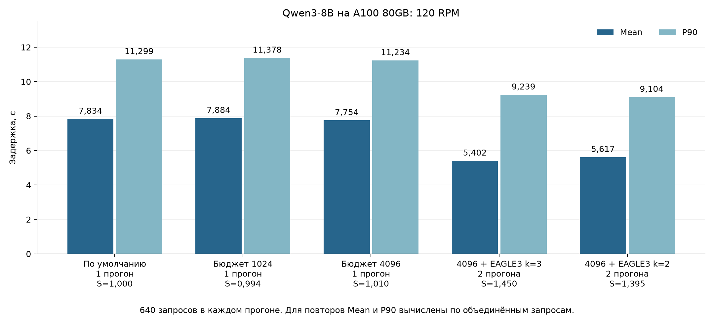
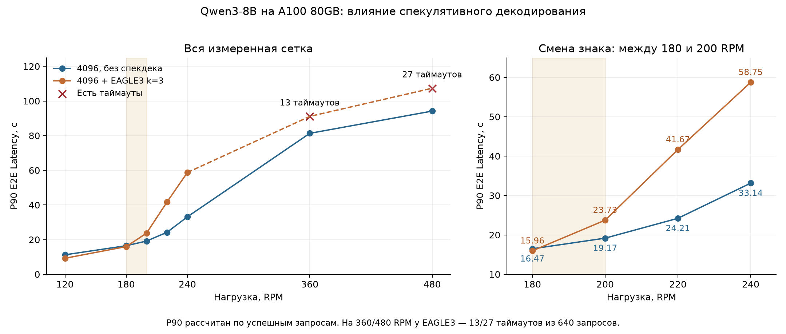
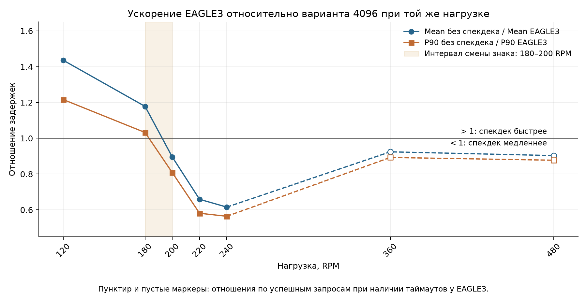
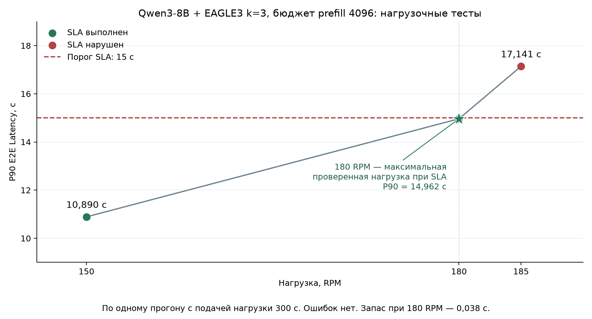

# ДЗ 6. Инференс Qwen3-8B

**Итог:** при 120 RPM измерены пять конфигураций; для EAGLE3 k=2 и k=3
выполнено по два прогона. Во всех семи замерах обработаны 640 запросов без ошибок.
Я выбрал бюджет prefill 4096 и EAGLE3 k=3: по двум прогонам Mean Latency
5,402 с, P90 9,239 с, ускорение относительно бейзлайна 1,450×.
При k=2 Mean выше (5,617 с), хотя P90 немного ниже (9,104 с).
Измерена сетка 120–480 RPM: первая проверенная нагрузка, где спекдек хуже
по Mean и P90, — 200 RPM. Переход уточнён до интервала 180–200 RPM;
при 360 и 480 RPM у спекдека есть таймауты.
В тестах по 300 секунд максимальная проверенная нагрузка с P90 < 15 с —
**180 RPM**: P90 = 14,962 с. При 185 RPM P90 = 17,141 с, SLA нарушен.

## Данные и условия

Я использую `Qwen/Qwen3-8B` и исходные 640 запросов из `data/requests.jsonl`.

Для экспериментов доступна одна NVIDIA A100 80GB.

## Методика

Бейзлайн запускается через `serve.sh` с настройками движка по умолчанию.
По логу используются BF16, FlashAttention 2, контекст до 40960 токенов,
prefix caching, chunked prefill и CUDA graphs в режиме `FULL_AND_PIECEWISE`.

Для каждого замера я сначала очищаю prefix KV-кеш, выполняю отдельный прогрев
на 40 исходных запросах при concurrency 8 и снова очищаю кеш.
Прогрев не входит в измеряемую выборку. После измерений кеш также очищается.
Кеши весов и компиляции сохраняются: загрузка модели и компиляция
не являются частью измеряемой latency.

Запросы отправляются последовательно из исходного файла с постоянной частотой
`RPS = RPM / 60`. Во время измерений клиентский лимит concurrency не задаётся.
Таймаут одного запроса — 120 секунд. После окончания подачи нагрузки скрипт
дожидается отправленных запросов с учётом этого таймаута.

### 1. Уменьшение latency при 120 RPM

| Конфигурация | RPM | Прогонов | Успешно | Mean Latency, с | P90 Latency, с | S |
| --- | ---: | ---: | ---: | ---: | ---: | ---: |
| vLLM 0.22.0, по умолчанию | 120 | 1 | 640/640 | 7,834 | 11,299 | 1,000 |
| `max-num-batched-tokens=1024` | 120 | 1 | 640/640 | 7,884 | 11,378 | 0,994 |
| `max-num-batched-tokens=4096` | 120 | 1 | 640/640 | 7,754 | 11,234 | 1,010 |
| Бюджет 4096 + EAGLE3, k=3 | 120 | 2 | 1280/1280 | 5,402 | 9,239 | 1,450 |
| Бюджет 4096 + EAGLE3, k=2 | 120 | 2 | 1280/1280 | 5,617 | 9,104 | 1,395 |

У бейзлайна средний TTFT — 0,137 с, средний ITL — 18,171 мс. Основное время ответа приходится
на генерацию после первого токена. По серверному `usage_completion_tokens`
средняя длина ответа — 420,931 токена: 419 ответов достигли ограничения 512,
221 завершился раньше. 
В `serve_prefill1024.sh` я задал `--max-num-batched-tokens 1024`. По
[документации vLLM](https://docs.vllm.ai/en/v0.22.0/configuration/optimization/#performance-tuning-with-chunked-prefill)
меньший бюджет токенов может уменьшить влияние prefill на задержку декодирования,
но увеличить TTFT. В этом прогоне гипотеза об ускорении не подтвердилась:
Mean вырос на 0,64%, P90 — на 0,69%, TTFT — до 0,147 с, ITL — до 18,289 мс.

В `serve_prefill4096.sh` я увеличил бюджет до 4096 токенов. Mean уменьшился
на 1,02%, P90 — на 0,58%. Средний TTFT составил 0,133 с, ITL — 18,014 мс.
Средняя длина ответа — 420,319 токена; у 135 запросов длина отличается от бейзлайна.
Это лучший результат среди вариантов без спекдека, но разница небольшая. Я использую 4096 как основу сравнения со спекдеком.

В `serve_eagle3_k3.sh` я включил EAGLE3 при бюджете 4096 с моделью
[RedHatAI/Qwen3-8B-speculator.eagle3](https://huggingface.co/RedHatAI/Qwen3-8B-speculator.eagle3).
Она обучена для Qwen3-8B с выключенным thinking; начальные три предлагаемых
токена я взял из примера в карточке модели. Целевая модель остаётся Qwen/Qwen3-8B.
Поддержка EAGLE3 описана в
[документации vLLM 0.22.0](https://docs.vllm.ai/en/v0.22.0/features/speculative_decoding/eagle/)
и проверена реальным запуском на A100. В обоих сравниваемых вариантах сохранились
BF16, FlashAttention 2, async scheduling, prefix caching и режим CUDA graphs
`FULL_AND_PIECEWISE`; `gpu_memory_utilization=0.92`.

В первом прогоне относительно варианта 4096 без спекдека Mean уменьшился на 30,34%
(ускорение 1,436×), P90 — с 11,234 до 9,292 с. Средний ITL снизился
с 18,014 до 12,487 мс, а TTFT вырос с 0,133 до 0,144 с.
Средняя длина ответа почти совпала: 420,319 и 420,467 токена соответственно.
Основное наблюдаемое улучшение — снижение задержки генерации при почти одинаковой
средней длине ответов. 

По счётчикам `profile/server_metrics_export.json` за измеряемую часть предложено
413604 токена в 137868 раундах, принято 131277 токенов (31,74%).
Средняя длина принятия по определению vLLM, включая бонусный токен,
равна `1 + 131277 / 137868 = 1,952`.
Первая, вторая и третья позиции приняты в 49,33%, 29,67% и 16,22% раундов.
Прогрев в эти значения не включён.

В `serve_eagle3_k2.sh` я уменьшил число предлагаемых токенов до двух.
В первом прогоне Mean вырос на 3,97% относительно k=3, а P90 снизился на 1,55%.
Средний ITL вырос с 12,487 до 12,952 мс; TTFT снизился с 0,144 до 0,141 с.
Средняя длина ответа увеличилась на 0,34%, до 421,903 токена.

При k=2 принято 121558 из 296636 предложенных токенов (40,98%),
но средняя длина принятия снизилась до `1 + 121558 / 148318 = 1,820`.
Более высокая доля принятых предложений сама по себе не дала меньшую Mean Latency.

Повторные замеры подтвердили преимущество k=3 по Mean:

| Вариант | Прогон | Mean Latency, с | P90 Latency, с |
| --- | ---: | ---: | ---: |
| EAGLE3 k=2 | 1 | 5,616 | 9,147 |
| EAGLE3 k=2 | 2 | 5,618 | 9,085 |
| EAGLE3 k=3 | 1 | 5,401 | 9,292 |
| EAGLE3 k=3 | 2 | 5,403 | 9,130 |

У каждого варианта Mean между повторами изменился менее чем на 0,05%,
тогда как у k=2 он примерно на 3,98% выше, чем у k=3. По главной метрике задания
выбираю `serve_eagle3_k3.sh` для дальнейших экспериментов. У k=2 объединённый P90
ниже на 0,135 с, но диапазоны P90 отдельных прогонов пересекаются.
Во вторых прогонах также нет ошибок, таймаутов, отмен и пропусков;

### 2. Влияние нагрузки на спекулятивное декодирование

Для сравнения я использую одинаковую сетку RPM и две конфигурации с одинаковыми
остальными настройками, отличающиеся включением спекулятивного декодирования.
Пару составляют `serve_prefill4096.sh` и выбранный `serve_eagle3_k3.sh`.
На каждой точке отправляются все 640 запросов после прогрева и очистки кеша.
Я измерил 120, 180, 200, 220, 240, 360 и 480 RPM. На графике ускорения сравниваю
`Mean без спекдека / Mean со спекдеком` при одной и той же нагрузке;
отдельно показываю отношение P90. Значение выше 1 означает выигрыш спекдека.

При 120 RPM для EAGLE3 объединены два прогона, остальные точки измерены по одному разу:

| RPM | P90 без спекдека, с | P90 EAGLE3 k=3, с | Отношение P90 | Ускорение по Mean | Таймауты без/со спекдеком |
| ---: | ---: | ---: | ---: | ---: | ---: |
| 120 | 11,234 | 9,239 | 1,216 | 1,435 | 0/0 |
| 180 | 16,471 | 15,958 | 1,032 | 1,178 | 0/0 |
| 200 | 19,172 | 23,735 | 0,808 | 0,895 | 0/0 |
| 220 | 24,215 | 41,668 | 0,581 | 0,659 | 0/0 |
| 240 | 33,140 | 58,745 | 0,564 | 0,615 | 0/0 |
| 360 | 81,332 | 91,107* | 0,893* | 0,924* | 0/13 |
| 480 | 94,169 | 107,347* | 0,877* | 0,903* | 0/27 |

При 360 RPM у EAGLE3
успешны 627/640 запросов, 13 завершились по таймауту 120 с (2,03%);
при 480 RPM — 613/640 и 27 таймаутов (4,22%). Поэтому эти отношения задержек
не описывают качество обслуживания всех запросов. Без спекдека на всей сетке
ошибок нет; при 180, 200, 220 и 240 RPM у EAGLE3 также успешны все 640 запросов.
Счётчик `completed_request_count=640` включает завершившиеся с ошибкой запросы.

Фактическая частота отправки отличается от заданной менее чем на 0,01 RPM
во всех новых замерах. Проверены 640 уникальных запросов в каждом прогоне,
хеш данных, версии пакетов и длины входов успешных ответов совпали.
Во всех прогревах успешны 40/40 запросов; очистка кеша завершалась с HTTP 200.

Первая измеренная нагрузка, при которой спекдек проигрывает, — **200 RPM**:
P90 выше на 23,80%, Mean — 14,435 с против 12,920 с без спекдека.
При 180 RPM он ещё быстрее, хотя ускорение по P90 составляет только 1,032×.
При 220 RPM проигрыш увеличивается: P90 — 41,668 с против 24,215 с.
Таким образом, по текущим замерам смена знака находится между 180 и 200 RPM.

При переходе от 180 к 240 RPM средний ITL у EAGLE3 вырос с 22,221 до 80,556 мс,
а среднее число запросов в исполняемом батче — с 26,8 до 111,0.
При 240 RPM у варианта без спекдека ITL равен 49,110 мс. Доля принятия EAGLE3
почти не изменилась: 31,64% и 31,74%, средняя длина принятия — около 1,95.
Поэтому ухудшение не сопровождается падением доли принятых предложений.
Я предполагаю, что на больших батчах дополнительная работа спекдека перестаёт
окупаться. 

На 360 и 480 RPM обе конфигурации достигали 256 исполняемых запросов,
а очереди ожидания — до 147/149 и 235/249 запросов без/со спекдеком.
У EAGLE3 дополнительно зарегистрированы 10 и 2 preemptions; без спекдека — 0.
Сокращение относительного проигрыша на этих нагрузках не означает восстановления
нормальной работы: задержки велики, а самые долгие ответы EAGLE3 исключены
из метрик успешных запросов из-за таймаутов.

### 3. Максимальная нагрузка при SLA

Я проверил выбранный вариант 4096 + EAGLE3 k=3 через `load_test.sh` при
150, 180 и 185 RPM. В каждом тесте нагрузка подавалась 300 секунд после
отдельного прогрева и очистки кеша. 

| RPM | Фактический RPM | Успешно | Ошибки / таймауты | P90 E2E, с | SLA < 15 с |
| ---: | ---: | ---: | ---: | ---: | --- |
| 150 | 150,0010 | 750/750 | 0/0 | 10,890 | Выполнен |
| **180** | **179,9994** | **900/900** | **0/0** | **14,962** | **Выполнен** |
| 185 | 185,0001 | 925/925 | 0/0 | 17,141 | Нарушен |

По событиям AIPerf подача нагрузки длилась 300,0004–300,0016 с.
Измеренная длительность с завершением последних ответов составила
304,537, 308,424 и 309,286 с соответственно. Во всех трёх тестах достигнута
заданная частота, отсутствуют ошибки, таймауты, отмены и пропуски.
Поэтому прохождение SLA при 180 RPM не скрывает неуспешные запросы,
а провал при 185 RPM вызван превышением P90.

